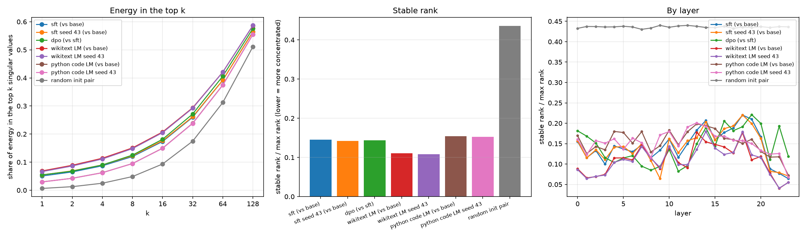

# Does alignment training change behavior, or just style?

Alignment training (SFT, then DPO) is what turns a raw base model into
something that follows instructions and talks like an assistant. What it
actually does to the weights is still an open question. The "superficial
alignment hypothesis" from LIMA says the model learned everything it knows
during pretraining, and alignment just picks the style to answer in. If that's
right, the weight change should be small and structured rather than spread out
everywhere.

This repo tests that on one laptop GPU: full SFT, DPO and a LoRA sweep on
Qwen2.5-0.5B, token-matched non-alignment controls, a second model family
(SmolLM2-360M), and six publicly released base/instruct pairs.

Short answer: the weight change *is* structured, but there's nothing
alignment-specific about it. Fine-tuning on Wikipedia or Python code produces
the same structure. The more useful finding turned out to be about measurement:
the rank measures used in this area, including the one behind a 2025 claim that
post-training is superficial, can't tell a fine-tuning update from random
noise. Stable rank can.



- Full write-up with every number: [docs/report.md](docs/report.md)
- The plan and predictions, written before training: [docs/plan.md](docs/plan.md)
- Prior work: [docs/related-work.md](docs/related-work.md)

## What came out of it

Roughly in order of how much I trust each one.

**The usual ways of measuring "is this update low-rank" can't see the answer.**
Counting singular values above 0.01·σ₁ puts the SFT weight delta at 99.07% of
max rank and two random initializations at 99.62%. The rank needed for 90% of
the energy gives 0.66 vs 0.72. Stable rank (‖ΔW‖²_F / ‖ΔW‖²₂) on the same saved
spectra says the SFT delta is 3x more concentrated than the random pair, with
8x more energy in its top direction. Both are true at once: ΔW has a long,
noise-like tail (so counting measures call it high rank) and a top few
directions that carry far more energy than noise would. This held for every
fine-tuning run I tried, on both model families.

**The concentration isn't about alignment.** I expected this one to go the
other way. A plain language-modeling run on wikitext, and another on Python
code, both matched to the SFT run's token count and settings, land in the same
band:

| Run | stable rank / max rank | vs noise | ‖ΔW‖_F |
|---|---|---|---|
| wikitext LM | 0.110 | 4.0x | 0.349 |
| DPO (on top of SFT) | 0.144 | 3.0x | 0.019 |
| Alpaca SFT | 0.145 | 3.0x | 0.280 |
| Python code LM | 0.154 | 2.8x | 0.127 |
| two random inits | 0.436 | | 35.28 |

Two kinds of training objective, three kinds of data, one narrow band. The
sizes of the changes differ 18x while the concentration barely moves.

**The differences inside that band are real.** Rerunning SFT and both controls
with a different seed and a different data sample moves stable rank by at most
0.0026. The gap between the code and wikitext runs is about 0.044, 17x bigger,
with a paired bootstrap interval of 0.033-0.054. SFT lands inside the range
the two controls span, though where inside it isn't consistent: on Qwen it
can't be told apart from code.

**It's not a Qwen quirk.** The same SFT and controls on SmolLM2-360M give the
same picture: every fine-tune 4-8x below its own noise floor, SFT inside the
range of the two controls, wikitext again more concentrated than code. The
threshold count reads 94-98% for all of them.

**The released instruct models show the same measurement problem.** For the
official base → instruct pairs of Qwen2.5 (0.5B, 1.5B) and SmolLM2 (135M,
360M, 1.7B), the threshold count reads 96-99%, within a few points of a random
matrix, while stable rank is 1.6x to 9x below it.

**The entropy effective rank used by Timber has the same blind spot, milder.**
Timber's evidence for superficial post-training is that eRank of each weight
matrix barely changes between base and instruct. A random perturbation of the
same size leaves it just as unchanged (every change, real or random, is under
0.5%). And eRank of ΔW sits within 3-18% of a random matrix, where stable rank
is 1.6-9x away. Checked on Qwen3-0.6B, one of their own pairs, where my
eRank(ΔW) matches theirs (83% vs their ~85%).

**A rank-1 LoRA adapter points the same way full fine-tuning does.** Comparing
ΔW_sft's top singular directions with the matching LoRA adapter's A/B matrices,
the overlap is about 11x what random subspaces give at rank 1, and stays above
random up to rank 128.

What didn't go as predicted is in [docs/report.md](docs/report.md). Briefly:
the LoRA rank sweep showed no style/capability crossover because rank 1 already
captured all of the style gain, GSM8K got steadily worse as rank went up, and
DPO's change had the same shape as SFT's at about 1/15th the size.

**Timber's edit doesn't depend on its cutoff, and does little on GSM8K.** On
Qwen3-0.6B, all 1,319 GSM8K problems × 8 samples: their eRank cutoff keeps
99% of ΔW's energy, and halving the tail past it changes pass@1 by +0.8 and
pass@8 by +0.8 points, both within noise. (The first 300 problems had shown
+3.3 on pass@8, which mostly didn't survive the full set.) A stable-rank cutoff
that halves 59% of the update can't be told apart from it. Dropping that 59%
outright costs 4 points of pass@1, so the noise-like tail of ΔW still matters
to the model.

Still open: whether the LoRA GSM8K trend survives lower learning rates.

## The machine

Everything ran locally, no cloud. The specs matter here because the 6GB of VRAM
drove almost every design decision.

| | |
|---|---|
| GPU | NVIDIA GeForce RTX 3060 Laptop, 6144 MiB VRAM |
| Driver | 592.00 |
| CPU | AMD Ryzen 9 5900HS, 8 cores / 16 threads |
| RAM | 15.4 GB |
| OS | Windows 11 Home, build 26200 |
| Python | 3.11.9 |
| PyTorch | 2.14.0+cu130 (CUDA 13.0 build) |
| Package manager | [uv](https://docs.astral.sh/uv/) |
| Disk | ~70 GB free if you run everything |

### Fitting a full fine-tune in 6GB

Full fine-tuning a 0.5B model in bf16 needs the weights (~1GB), the gradients
(~1GB) and the AdamW states (~4GB in fp32). That's already over 6GB before any
activations. Three things make it fit, and you need all three:

- 8-bit AdamW from `bitsandbytes`, which cuts the optimizer states by about 4x
- gradient checkpointing, which recomputes activations on the backward pass
  instead of keeping them (costs maybe 30% speed)
- batch size 1 with 16 steps of gradient accumulation, for an effective batch
  of 16 without holding 16 sequences of activations at once

They're in [configs/model_qwen2.5_0.5b.yaml](configs/model_qwen2.5_0.5b.yaml).
Take any one out and it OOMs.

LoRA needs none of that, since only the adapters have optimizer state. The
sweep uses plain AdamW, batch 4 and no checkpointing, which is why a LoRA step
is quicker than a full fine-tuning step even though the forward pass is the
same.

Qwen2.5-1.5B doesn't fit for full fine-tuning at all (the optimizer states alone
want 20GB+). That's why my own training runs stop at 0.5B; the released pairs
go up to 1.7B because measuring them needs no training.

## Setup

```bash
uv sync --extra eval --extra quant --extra dev
uv run python scripts/check_env.py
```

`check_env.py` checks the imports, that torch can see the GPU, and how much VRAM
you have, so you find out early if your machine doesn't match the configs.

What the extras are for:

- `eval`: `lm-eval`, plus `langdetect` and `immutabledict`. IFEval needs those
  two but lm-eval doesn't list them, which I found out from a crashed run.
- `quant`: `bitsandbytes`, for the 8-bit optimizer.
- `dev`: pytest and ruff. `uv run pytest` runs the tests for the analysis code.

`pyproject.toml` pulls torch from PyTorch's cu130 index, because the default
Windows wheel on PyPI is CPU-only. Change that URL to match your own driver.

## Running it

Everything can be stopped and restarted. Run the same command again and it
continues from the last checkpoint, or skips the step if it's already done.

```bash
# reference weights for the SVD comparisons (--random adds the noise floor pair)
uv run python scripts/save_reference_models.py --random

# baseline evals on the untouched model
uv run python scripts/run_evals.py --checkpoint Qwen/Qwen2.5-0.5B --label base

# full SFT, evals, and SVD of the delta
uv run python scripts/train_sft.py --config configs/sft.yaml
uv run python scripts/run_evals.py --checkpoint checkpoints/sft --label sft
uv run python scripts/svd_deltas.py --before checkpoints/base --after checkpoints/sft --tag sft --out results/svd_sft
uv run python scripts/svd_deltas.py --before checkpoints/random_init_a --after checkpoints/random_init_b --tag random --out results/svd_control_random

# LoRA sweep (24 runs), evals on each rank's best run, then the plot
uv run python scripts/lora_sweep.py --config configs/lora_sweep.yaml
for r in 1 2 4 8 16 32 64 128; do
  uv run python scripts/run_evals.py --checkpoint checkpoints/lora_sweep/r${r}_lr1e-04 --label lora_r${r}
done
uv run python scripts/plot_lora_sweep.py

# DPO on top of SFT, measured against W_sft rather than base
uv run python scripts/train_dpo.py --config configs/dpo.yaml
uv run python scripts/run_evals.py --checkpoint checkpoints/dpo --label dpo
uv run python scripts/svd_deltas.py --before checkpoints/sft --after checkpoints/dpo --tag dpo --out results/svd_dpo
uv run python scripts/plot_sft_vs_dpo.py

# does LoRA find the same directions as full fine-tuning?
uv run python scripts/lora_overlap.py

# controls and the second seed (same trainer, different configs)
uv run python scripts/train_sft.py --config configs/control_lm.yaml
uv run python scripts/train_sft.py --config configs/control_code.yaml
uv run python scripts/train_sft.py --config configs/sft_seed43.yaml
uv run python scripts/train_sft.py --config configs/control_lm_seed43.yaml
uv run python scripts/train_sft.py --config configs/control_code_seed43.yaml
# ...then svd_deltas.py on each against checkpoints/base, into results/svd_<name>

# stable rank across everything above, and a check that the report's files exist
uv run python scripts/stable_rank.py
uv run python scripts/check_artifacts.py

# released base/instruct pairs (no training, ~17GB of downloads)
uv run python scripts/released_pairs.py

# Timber's entropy eRank on all of the above, with same-size random perturbations
uv run python scripts/timber_check.py

# 95% intervals (layer bootstrap) for all of the spectral numbers
uv run python scripts/error_bars.py

# Timber's edit with an eRank vs a stable-rank cutoff, pass@k on GSM8K (~9.5 h)
uv run python scripts/timber_cutoff.py --limit 300
uv run python scripts/timber_cutoff.py --limit 1319 --variants instruct erank_l0.5 stable_l0.5  # ~16 h more
```

The SmolLM2-360M runs and their SVDs are listed in
[docs/next-runs.md](docs/next-runs.md), ending with
`scripts/stable_rank.py --family smollm2`.

The `for` loop is bash. In PowerShell it's
`foreach ($r in 1,2,4,8,16,32,64,128) { ... "r${r}_lr1e-04" ... }`.

The controls and the second seed go through `train_sft.py` like the main run.
The control configs set `data.format: text`, which switches it to plain
language modeling with no chat template and no prompt masking.

### How long things take

Measured on the machine above:

| | |
|---|---|
| base model evals | ~4 h (IFEval alone was 2h19m) |
| SFT, 3 epochs, 1.75M tokens | 2h25m |
| LoRA sweep, 24 runs | ~37 h |
| evals per LoRA rank | ~4 h each |
| DPO, 1 epoch | 12h19m |
| wikitext control | ~2h25m |
| code control | ~2 h |
| SFT second seed | 2h10m |
| control second seeds | 2h28m (wikitext), 1h16m (code) |
| SmolLM2-360M SFT / wikitext / code | 2h47m / 3h06m / 57m |
| released pairs, all five | ~1 h, mostly downloading |
| `timber_check.py`, all 13 | ~1.5 h (SVDs of full W, mostly CPU-bound loading) |
| `timber_cutoff.py`, 300 problems × 5 variants | ~7.5 h (~75 s per 4 problems × 8 samples) |
| any SVD or plotting script | seconds to a few minutes |

DPO is slow because every step does four forward passes (the policy and the
frozen reference model, each on the chosen and the rejected answer) instead of
one.

All in, that's several days of GPU time. I ran it in chunks over about two
weeks, which is why resuming got built early.

## Layout

```
configs/        one yaml per run. the actual experimental settings live here
docs/           plan, related work, and the results write-up
src/align_geometry/
  data/         loading: sft_dataset, dpo_dataset, lm_dataset (plain text, for controls)
  train/        sft.py (also runs the controls), lora.py, dpo.py, common.py (manifests, resume)
  analysis/     svd_delta.py, subspace_overlap.py
  eval/         lm-eval wrapper and the XSTest refusal scorer
scripts/        everything you actually run
tests/          tests for the linear algebra
data/processed/ exact rows each run trained on
results/        eval table, SVD summaries and spectra, plots
checkpoints/    model weights, not in git (~66 GB); only each run's manifest.json is
```

## Data and benchmarks

Training: 10k examples from Alpaca-cleaned for SFT, 10k preference pairs from
UltraFeedback for DPO. The controls use wikitext-103 and CodeParrot, picked to
hit the same 1,750,543 tokens the SFT run trained on.

Style: IFEval checks whether an answer obeys a literal instruction ("exactly
three paragraphs", "no commas"), scored by rules rather than a judge model.
XSTest counts refusals on 450 prompts, half that sound risky but are fine and
half that are actually unsafe. The two refusal rates are kept separate, because
averaging them hides whether a model refuses too much or too little. It only
classifies refuse vs comply; nothing harmful is generated or graded.

Capability: GSM8K (grade school math, 5-shot, exact match) and ARC-Challenge
(multiple choice science, scored by log-likelihood).

## Reproducibility

Each training run writes a `manifest.json` next to its checkpoint: config hash,
seeds, package versions, loss, runtime, and how many tokens it actually trained
on. The exact rows each run used are in `data/processed/` rather than just a
seed, so the data can be rebuilt even if `datasets` changes how it shuffles.

Two caveats about those manifests. They were written before this repo had any
commits, so `git_commit` is null in all of them. And their config hashes come
from before I cleaned up the comments in `configs/`; only comments changed, the
values are the same.

## Things that went wrong

In case any of these save you some time.

- **NLTK crashes on Windows if a drive letter has no filesystem.** It looks for
  `nltk_data` on `C:\`, `D:\`, `E:\` and so on, and `os.path.realpath` throws
  WinError 1005 on an empty card reader. Downloading `punkt_tab` into the
  default location beforehand avoids it.
- **Windows sleep kills long runs.** The sleep timer only counts keyboard and
  mouse activity, not GPU load, so a 12 hour job gets suspended after 20 idle
  minutes. Run `powercfg /change standby-timeout-ac 0` first.
- **A half-written checkpoint can't be resumed.** Hugging Face writes
  `trainer_state.json` last, so killing a job mid-save leaves the 1GB model file
  but no state file, and resuming crashes. `train/common.py` spots that and
  deletes the broken checkpoint.
- **DPO runs out of memory during eval, not training.** The eval step builds
  full-vocabulary logits (151,936 wide) for an entropy stat while both models
  are loaded, and the default eval batch is bigger than the training one. Set
  `per_device_eval_batch_size` yourself.
- **Two GPU jobs at once on 6GB is a bad idea.** VRAM hit 5980/6144 MiB and
  each batch took about three times as long.
- **Token budgets have to account for truncation.** Counting a document's full
  length is wrong when the trainer cuts it at 1024 tokens. That was fine for
  wikitext (no line went over) but would have overstated the code control's
  budget by about 4x, since code files average ~776 tokens after truncation
  against ~170 for wikitext.

## References

More detail on each paper and how it relates in
[docs/related-work.md](docs/related-work.md).

The hypothesis being tested
- Zhou et al. 2023. LIMA: Less Is More for Alignment. <https://arxiv.org/abs/2305.11206>
- Lin et al. 2023. The Unlocking Spell on Base LLMs (URIAL). <https://arxiv.org/pdf/2312.01552>

Low-rank structure in fine-tuning
- Aghajanyan et al. 2021. Intrinsic Dimensionality Explains the Effectiveness of Language Model Fine-Tuning. <https://aclanthology.org/2021.acl-long.568/>
- Timber 2025. Training-free Instruct Model Refining with Base via Effective Rank. <https://arxiv.org/html/2509.23595> (closest to the SVD part; uses Roy & Vetterli's entropy effective rank, checked in `scripts/timber_check.py`)
- Kalajdzievski 2023. Efficient Storage of Fine-Tuned Models via Low-Rank Approximation of Weight Residuals. <https://arxiv.org/pdf/2305.18425>

Where alignment sits in the network
- Chaudhury 2025. Alignment is Localized: A Causal Probe into Preference Layers. <https://arxiv.org/abs/2510.16167>
- Zhao et al. 2026. A Layer-wise Analysis of Supervised Fine-Tuning. <https://arxiv.org/abs/2604.11838>
- 2025. Massive Supervised Fine-tuning Experiments Reveal How Data, Layer, and Training Factors Shape LLM Alignment Quality. <https://arxiv.org/pdf/2506.14681>
- Qi et al. 2024. Safety Alignment Should Be Made More Than Just a Few Tokens Deep. <https://arxiv.org/pdf/2406.05946>

LoRA rank and capacity
- Biderman et al. 2024. LoRA Learns Less and Forgets Less. <https://arxiv.org/abs/2405.09673> (why the sweep tries three learning rates per rank; also measures ΔW's spectrum with a 90%-energy rank)
- Shuttleworth et al. 2025. LoRA vs Full Fine-tuning: An Illusion of Equivalence. <https://arxiv.org/abs/2410.21228>
- Ping et al. 2024. Delta-CoMe: Training-Free Delta-Compression with Mixed-Precision for Large Language Models. <https://arxiv.org/abs/2406.08903>
- Paul 2026. Spectral Geometry of LoRA Adapters Encodes Training Objective and Predicts Harmful Compliance. <https://arxiv.org/abs/2604.08844>
- Rudelson & Vershynin 2007. Sampling from Large Matrices (stable rank). <https://arxiv.org/abs/math/0503442>
- Roy & Vetterli 2007. The Effective Rank: A Measure of Effective Dimensionality. EUSIPCO.
- 2024. Planning vs Reasoning: Ablations to Test Capabilities of LoRA Layers. <https://arxiv.org/html/2412.00029>
- 2025. How Much is Too Much? Exploring LoRA Rank Trade-offs. <https://aclanthology.org/2025.findings-ijcnlp.58.pdf>
- Thinking Machines Lab. LoRA Without Regret. <https://thinkingmachines.ai/blog/lora/>

Model and benchmarks
- Qwen Team 2024. Qwen2.5 Technical Report. <https://arxiv.org/pdf/2412.15115>
- Zhou et al. 2023. IFEval. <https://arxiv.org/abs/2311.07911>
- Röttger et al. 2024. XSTest. <https://arxiv.org/abs/2308.01263>
- Cobbe et al. 2021. GSM8K. <https://arxiv.org/abs/2110.14168>
- Clark et al. 2018. ARC. <https://arxiv.org/abs/1803.05457>
- EleutherAI. LM Evaluation Harness. <https://github.com/EleutherAI/lm-evaluation-harness>

## License

MIT, see [LICENSE](LICENSE).
