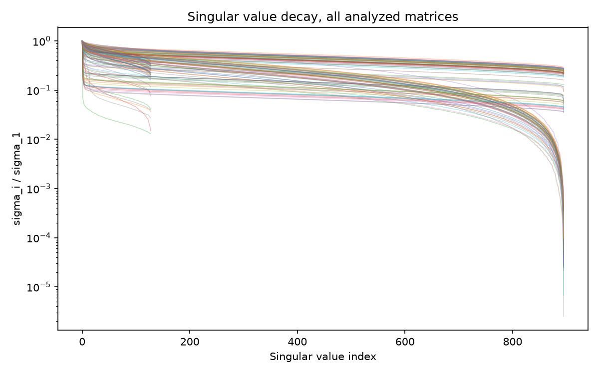
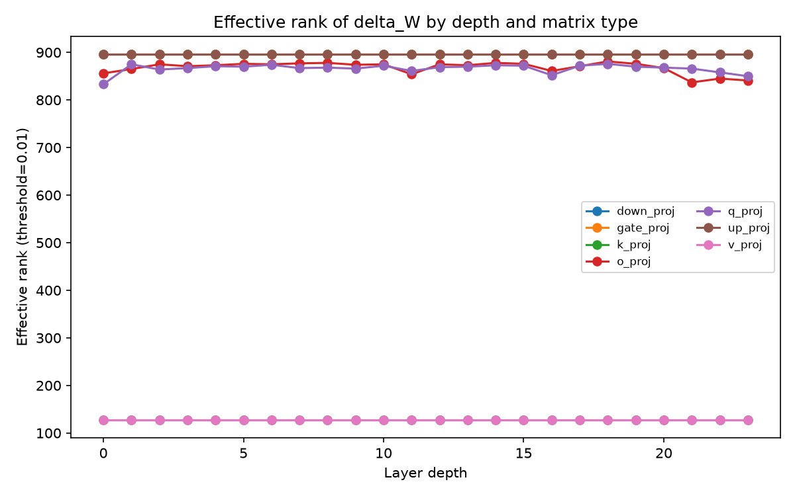
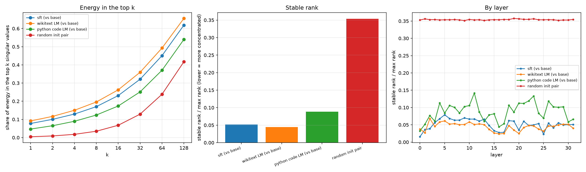
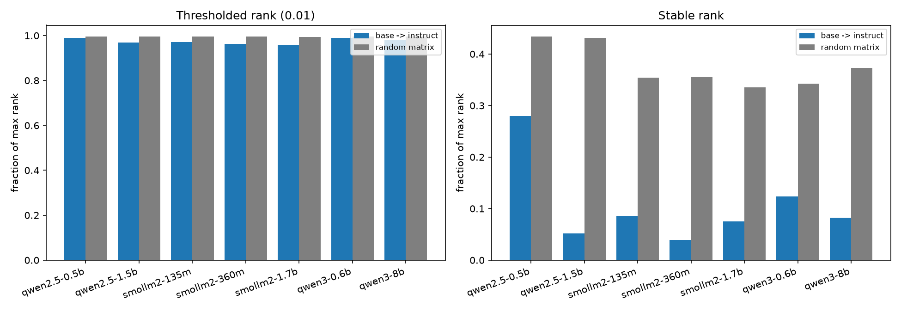
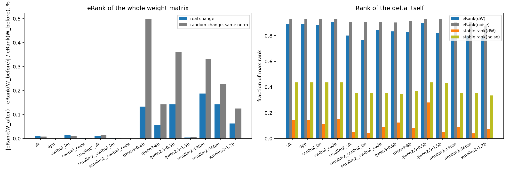
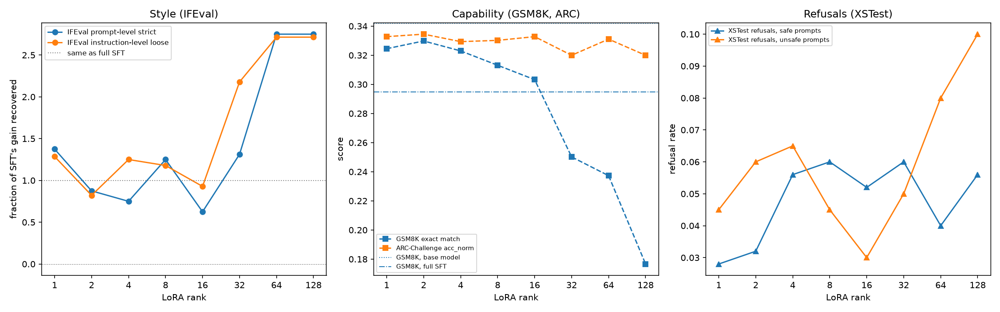
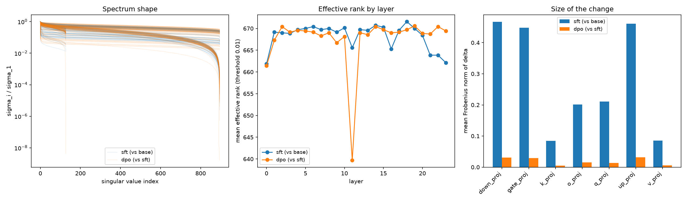
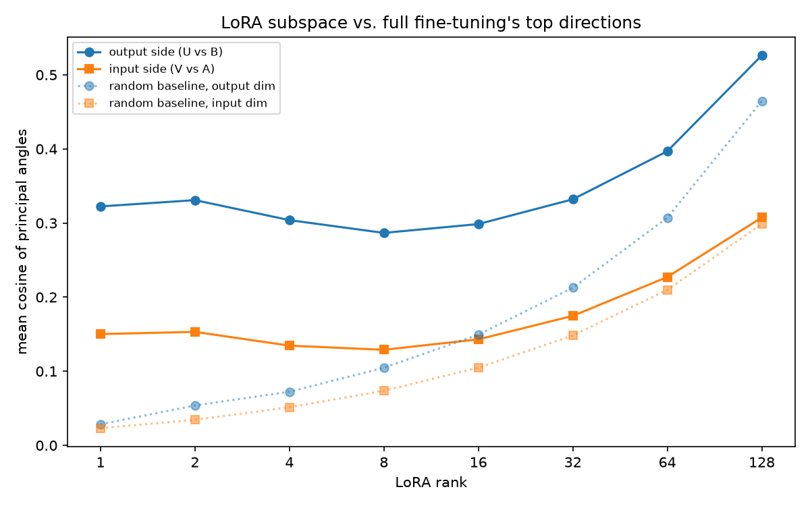

# Does alignment training change behavior, or just style?

Results write-up. Everything was run on a single RTX 3060 Laptop GPU with 6GB
of VRAM. The main experiments are on Qwen2.5-0.5B (base); the weight-geometry
result is then checked on SmolLM2-360M (section 5) and on seven publicly
released base/instruct pairs from 135M to 8B (section 6), including two from
the Timber paper.

The plan, with predictions written before any training, is in
[plan.md](plan.md). Prior work is in [related-work.md](related-work.md).

## Short version

I expected alignment training to leave a narrow, low-rank footprint in the
weights, and expected that footprint to be what makes alignment "superficial".
The first half held up once I measured it properly. The second half didn't.
Fine-tuning on Wikipedia text or on Python code leaves the same kind of
footprint, so it's just what fine-tuning does.

| Prediction | Result |
|---|---|
| (a) the SFT weight delta is low-rank, because of alignment | **No**, though not how it first looked. The delta is concentrated (3x lower stable rank than noise), but two fine-tunes with no alignment content are just as concentrated. |
| (b) LoRA needs more rank for capability than for style, with a crossover rank | **No crossover.** Rank 1 already gets all of the style gain. GSM8K gets steadily *worse* as rank goes up. |
| (c) DPO's delta is more concentrated than SFT's | **No.** Same concentration, about 15x smaller. |
| (d) LoRA finds the same directions as full fine-tuning | **Yes.** About 11x above chance at rank 1, above chance at every rank. |

The thing most likely to be useful to someone else: the standard way of
measuring this got it backwards. Counting singular values above 0.01·σ₁ said
the SFT delta looked exactly like random noise. Stable rank on the same saved
spectra said it's three times more concentrated than noise. Same data, opposite
answer. The same thing shows up in a second model family and in the official
base → instruct releases of Qwen2.5, Qwen3 and SmolLM2 up to 8B, where the
threshold count reads 96-99% everywhere while stable rank sits 1.6x to 9x
below noise.

Two other common measures share the blind spot in milder form: the rank needed
for 90% of the energy (Biderman et al. 2024) and the entropy effective rank
Timber uses. Timber's evidence that post-training is superficial, an unchanged
eRank of each weight matrix, turns out to be what any random perturbation of
the same size produces (section 6).

## Setup

- **Model:** `Qwen/Qwen2.5-0.5B` base. Picked the base rather than -Instruct so
  that my SFT run is the first instruction tuning it ever sees.
- **SFT:** full fine-tune on 10k examples from `yahma/alpaca-cleaned`, 3 epochs,
  lr 2e-5. bf16, 8-bit AdamW and gradient checkpointing to fit in 6GB.
- **DPO:** full fine-tune on top of the SFT checkpoint, 10k pairs from
  `ultrafeedback_binarized`, 1 epoch, β 0.1, lr 5e-6.
- **LoRA sweep:** ranks 1, 2, 4 ... 128, each at three learning rates (1e-4,
  3e-4, 1e-3), same data and tokens as the SFT run. Best LR per rank chosen by
  validation loss. 24 runs.
- **Controls:** two random initializations of the same architecture, as a noise
  floor; a plain LM fine-tune on wikitext-103; a plain LM fine-tune on Python
  code (CodeParrot). The two LM runs match the SFT run's token budget and
  settings exactly; only the data changes.
- **Repeats:** SFT and both LM controls run again with both the training seed
  and the data sample changed (42 → 43), to see how much numbers move between
  identical runs.
- **Second family:** SFT plus the two LM controls on `HuggingFaceTB/SmolLM2-360M`
  (base), same recipe and memory settings, with its own random-init pair. The
  base tokenizer has no chat template, so SFT borrows the one from
  SmolLM2-360M-Instruct. Weight geometry only, no evals.
- **Released pairs:** Qwen2.5-0.5B/1.5B, SmolLM2-135M/360M/1.7B and
  Qwen3-0.6B/8B, base vs the official instruct model, measured with no
  training at all. Weights are read one matrix at a time, so the 8B pair fits
  in 16GB of RAM.
- **Evals,** the same on every checkpoint: IFEval (541 prompts) and XSTest
  refusals (450 prompts, safe and unsafe halves kept separate) for style;
  GSM8K (1319, 5-shot, exact match) and ARC-Challenge (1172) for capability.
- **SVD:** every attention and MLP weight matrix (`q/k/v/o_proj`,
  `gate/up/down_proj`), 168 per model, measured both as thresholded effective
  rank and as stable rank / top-k energy.

## 1. Base vs SFT

| | Base | SFT | Change |
|---|---|---|---|
| IFEval, prompt-level strict | 12.01% | 14.97% | +2.96 |
| IFEval, instruction-level loose | 24.82% | 28.18% | +3.35 |
| XSTest refusals, safe prompts | 1.2% | 4.4% | +3.2 |
| XSTest refusals, unsafe prompts | 2.0% | 5.0% | +3.0 |
| GSM8K | 34.19% ±1.31 | 29.49% ±1.26 | **−4.70** |
| ARC-Challenge (acc_norm) | 32.34% ±1.37 | 33.62% ±1.38 | +1.28 (noise) |

SFT bought about 3 points of instruction-following and paid for it with almost
5 points of GSM8K. That drop is about 3.6x its stderr, so it's real. ARC didn't
move beyond noise. Refusals went up by about the same amount on safe and unsafe
prompts, which looks like formatting bleeding through more than the model
learning when to refuse; Alpaca has almost no refusal examples in it.

## 2. Is the SFT weight delta low-rank?

### The planned measurement

Effective rank as a share of the maximum possible, compared against the same
thing for two random inits:

| | SFT − base | two random inits |
|---|---|---|
| threshold 0.01 | 99.07% | 99.62% |
| threshold 0.1 | 81.04% | 96.37% |

At the planned threshold the SFT delta is indistinguishable from noise. Only at
0.1 does anything show up, mostly in `q_proj`, `o_proj`, `gate_proj` and
`up_proj` in the last few layers (layer 23's `up_proj` drops to 22 out of 896).
Taken at face value, that's prediction (a) failing.

### Measuring it without a threshold

The problem is that counting singular values above some fraction of the biggest
one tells you nothing about how the energy is spread among the ones you
counted. Almost any dense matrix comes out near full rank. So I recomputed from
the same saved spectra, no retraining, with two measures that don't depend on a
cutoff or on overall scale:

- stable rank = ‖ΔW‖²_F / ‖ΔW‖²₂ = Σσᵢ² / σ₁²
- energy in the top k = share of Σσᵢ² in the k largest values

| average over 168 matrices | SFT | DPO | random inits |
|---|---|---|---|
| stable rank / max rank | 0.145 | 0.144 | 0.436 |
| energy in top 1 | 5.06% | 5.47% | 0.64% |
| energy in top 8 | 12.0% | 12.5% | 4.9% |
| energy in top 32 | 26.0% | 27.2% | 17.5% |

By matrix type (stable rank / max rank):

| | q_proj | o_proj | up_proj | gate_proj | k_proj | down_proj | v_proj |
|---|---|---|---|---|---|---|---|
| SFT | 0.068 | 0.080 | 0.096 | 0.103 | 0.135 | 0.217 | 0.316 |
| random inits | 0.252 | 0.251 | 0.492 | 0.492 | 0.536 | 0.493 | 0.535 |
| ratio | 3.7x | 3.1x | 5.1x | 4.8x | 4.0x | 2.3x | 1.7x |

So the SFT delta is clearly concentrated: stable rank 3x lower than noise, and
its top direction carries about 8x the share of energy. It holds for every
matrix type and is strongest in the MLP projections. It's not *low-rank* in the
literal sense, though. The spectrum is still dense, which is exactly why the
threshold count missed it.

Another count-style measure, the rank needed to hold 90% of the energy (the one
Biderman et al. 2024 use), has the same problem in a milder form: 0.66 of max
rank for SFT against 0.72 for the random pair. Both views are true at once.
The bulk of ΔW's spectrum is a long tail that looks like noise, so anything
that counts directions calls it high rank; the top few directions carry far
more energy than noise would, and that's what stable rank picks up.

## 3. Is that because of alignment?

Showing the delta beats random noise doesn't say anything about alignment.
Fine-tuning might always look like this. So I fine-tuned the same base model
again with the same settings and the same number of tokens, on data with no
instructions, no chat format and no preferences in it.

**wikitext-103** (1,714,520 tokens, vs 1,750,543 for SFT):

| | SFT | wikitext | random inits |
|---|---|---|---|
| stable rank / max rank | 0.145 | 0.110 | 0.436 |
| energy in top 1 | 5.06% | 6.87% | 0.64% |
| energy in top 8 | 12.0% | 15.1% | 4.9% |
| energy in top 32 | 26.0% | 29.4% | 17.5% |
| mean ‖ΔW‖_F | 0.280 | 0.349 | 35.28 |

| | q_proj | o_proj | up_proj | gate_proj | k_proj | down_proj | v_proj |
|---|---|---|---|---|---|---|---|
| SFT | 0.068 | 0.080 | 0.096 | 0.103 | 0.135 | 0.217 | 0.316 |
| wikitext | 0.057 | 0.069 | 0.074 | 0.090 | 0.119 | 0.135 | 0.229 |

The wikitext run is at least as concentrated as SFT, on every matrix type. And
it isn't a weaker update that happens to look tidier: it moved the weights
further than SFT did.

**Python code** (1,718,163 tokens). Two tasks agreeing could be a fluke, so I
added one that's about as unlike both as possible:

| | stable rank / max rank | vs noise | energy top 1 | ‖ΔW‖_F |
|---|---|---|---|---|
| wikitext | 0.110 | 4.0x | 6.87% | 0.349 |
| DPO | 0.144 | 3.0x | 5.47% | 0.019 |
| SFT | 0.145 | 3.0x | 5.06% | 0.280 |
| code | 0.154 | 2.8x | 2.97% | 0.127 |
| random inits | 0.436 | | 0.64% | 35.28 |

Four deltas from two kinds of training objective and three kinds of data all
land between 0.110 and 0.154, against 0.436 for noise. Their sizes differ 18x
and their concentration barely moves, so size and concentration are separate
things, which is why a scale-free measure is needed here.

It's a band, not a constant. Code is the least concentrated and wikitext the
most, and the top-1 energy differs more than twofold between them. Section 4
checks whether that spread is real.

**So for prediction (a):** the measurement holds up, the interpretation doesn't.
Fine-tuning deltas really are concentrated and the threshold count really does
miss it, but there's nothing alignment-specific about it. The prediction was
about alignment, so it fails.

## 4. How much is noise?

I repeated the SFT run and both LM controls with a different training seed
*and* a different data sample (a different 10k Alpaca examples, a different
token-matched slice of wikitext and of CodeParrot).

| | seed 42 | seed 43 | difference | energy top 1 (42 / 43) |
|---|---|---|---|---|
| wikitext | 0.1104 | 0.1082 | 0.0022 | 6.87% / 6.63% |
| SFT | 0.1450 | 0.1424 | 0.0026 | 5.06% / 5.45% |
| code | 0.1540 | 0.1522 | 0.0018 | 2.97% / 2.93% |

Averaged over both seeds: wikitext 0.109, SFT 0.144, code 0.153. The code vs
wikitext gap (0.044) is about 17 times the largest seed-to-seed difference
(0.0026), and the order of the three is the same at both seeds. Per matrix
type the SFT repeat is just as tight: `o_proj` 0.0799 vs 0.0794, `q_proj`
0.0681 vs 0.0694, worst is `v_proj` at 0.3160 vs 0.3018. Two independent runs
agree to within about 2% on stable rank, which is what makes the other numbers
in sections 2 and 3 worth anything.

### Error bars across matrices

Seeds are one source of noise. The other is which matrices go into the
average: every number here is a mean over 168 (or 224) matrices, and layers
differ a lot. `scripts/error_bars.py` resamples whole layers (matrices in the
same layer aren't independent) 5,000 times and gives 95% intervals. For
comparing two runs it uses the *paired* difference, since both runs have the
same matrices.

| Qwen2.5-0.5B, stable rank / max rank | mean | 95% interval |
|---|---|---|
| SFT | 0.145 | 0.129 - 0.161 |
| wikitext | 0.110 | 0.096 - 0.124 |
| code | 0.154 | 0.142 - 0.165 |
| random inits | 0.436 | 0.435 - 0.437 |
| SFT, noise / real | 3.0x | 2.7 - 3.4x |
| wikitext, noise / real | 3.9x | 3.5 - 4.5x |
| code, noise / real | 2.8x | 2.6 - 3.1x |

| paired difference in stable rank | Qwen | SmolLM2 |
|---|---|---|
| code − wikitext | +0.044 (0.033 - 0.054) | +0.044 (0.036 - 0.052) |
| SFT − wikitext | +0.035 (0.025 - 0.045) | +0.007 (0.003 - 0.011) |
| code − SFT | +0.009 (−0.003 - 0.020) | +0.037 (0.029 - 0.045) |
| seed 43 − seed 42, SFT | −0.003 (−0.010 - 0.003) | |
| seed 43 − seed 42, wikitext | −0.002 (−0.007 - 0.002) | |
| seed 43 − seed 42, code | −0.002 (−0.008 - 0.004) | |

This corrects something I'd have said otherwise. Every fine-tune is well below
noise, with intervals nowhere near overlapping, and wikitext is more
concentrated than code on both models. But SFT's place in between isn't the
same on both. On Qwen, SFT and code can't be told apart (the interval crosses
zero); on SmolLM2, SFT sits close to wikitext. So the safe statement is that
SFT lands inside the range the two non-alignment controls span, not at any
consistent spot within it. The seed differences all straddle zero, as they
should.

## 5. Does it hold on another model?

Everything above is one architecture. So I reran the core of it on
SmolLM2-360M base: SFT on Alpaca (1,920,060 tokens), the wikitext control
(1,880,834) and the code control (1,883,657), all with the same settings as
the Qwen runs, plus a SmolLM2 random-init pair as its own noise floor.

| SmolLM2-360M | threshold 0.01 | threshold 0.1 | stable rank / max rank | vs noise | energy top 1 | ‖ΔW‖_F |
|---|---|---|---|---|---|---|
| wikitext | 94.3% | 54.8% | 0.045 | 7.9x | 9.17% | 0.552 |
| SFT | 95.5% | 61.0% | 0.052 | 6.9x | 7.76% | 0.495 |
| code | 97.6% | 78.0% | 0.089 | 4.0x | 4.69% | 0.075 |
| random inits | 99.6% | 96.4% | 0.354 | | 0.45% | 31.24 |

Same picture as Qwen. The threshold count puts everything in the mid-to-high
90s next to noise at 99.6%; stable rank puts every fine-tune 4-8x below noise.
SFT again lands inside the range of the two non-alignment controls, and as on
Qwen, wikitext is the most concentrated and code the least (paired intervals
in section 4). Where SFT falls inside that range differs: close to wikitext
here, close to code on Qwen. SmolLM2's deltas are more concentrated than
Qwen's across the board (0.05 vs 0.14 for SFT), so the *level* depends on the
model, but the main comparison (alignment SFT is not special) doesn't.

## 6. Released base/instruct pairs

My runs are small: 10k examples, a couple of million tokens. The models people
actually use are post-trained with far more data and mixed objectives
(SFT, preference tuning, sometimes RL). Prior work on these pairs (Timber,
see [related-work.md](related-work.md)) concluded from effective rank that
post-training is superficial; their exact measure is checked in the next
subsection. First, I measured the official releases the
same way as my own runs, with no training: ΔW = W_instruct − W_base for every
attention and MLP matrix, next to a Gaussian matrix of the same shape. (A
Gaussian matrix gives the same stable rank as my random-init pair: 0.434 vs
0.436 for Qwen2.5-0.5B's shapes.)

| pair | threshold 0.01 | noise | stable rank / max rank | noise | noise / real |
|---|---|---|---|---|---|
| Qwen2.5-0.5B | 99.0% | 99.6% | 0.280 | 0.434 | 1.6x |
| Qwen2.5-1.5B | 96.9% | 99.6% | 0.051 | 0.432 | 8.4x |
| SmolLM2-135M | 97.1% | 99.6% | 0.086 | 0.354 | 4.1x |
| SmolLM2-360M | 96.4% | 99.6% | 0.039 | 0.356 | 9.1x |
| SmolLM2-1.7B | 95.9% | 99.3% | 0.075 | 0.336 | 4.5x |
| Qwen3-0.6B | 98.9% | 99.6% | 0.124 | 0.342 | 2.8x |
| Qwen3-8B | 98.0% | 99.6% | 0.082 | 0.373 | 4.5x |

The threshold count says every release is within a few points of noise, which
is what it said about my runs too. Stable rank says every one of them is more
concentrated than noise, by 1.6x to 9x. So the measurement problem isn't
something about my small runs; it applies directly to the setting the prior
work measured, and it holds at 8B: on Qwen3-8B, one of Timber's own pairs, the
threshold count reads 98.0% against 99.6% for noise while stable rank is 4.5x
below it.

With layer-bootstrap 95% intervals on the noise / real ratio: Qwen2.5-0.5B
1.45-1.69x, Qwen2.5-1.5B 7.7-9.2x, SmolLM2-135M 3.5-5.0x, SmolLM2-360M
8.0-10.6x, SmolLM2-1.7B 4.2-4.9x, Qwen3-0.6B 2.6-3.0x, Qwen3-8B 4.2-5.0x.
None comes near 1.

Qwen2.5-0.5B is the outlier, only 1.6x below noise and less concentrated than
my own SFT of the same base (0.145). I don't know why. Its instruct model went
through a much bigger and more varied post-training pipeline than anything here,
and the other four pairs don't look like it, so I'd treat it as an open
question rather than a pattern. Nothing here says *what* the released
post-training did, only that its weight change isn't noise-like.

### Timber's own measure

I had assumed Timber used the 0.01·σ₁ threshold count. Going back to the paper,
they don't. They use Roy & Vetterli's entropy effective rank,
eRank = exp(−Σ pᵢ log pᵢ) with pᵢ = σᵢ / Σσⱼ, and their evidence for
superficiality is that eRank(W_base) and eRank(W_instruct), of the *whole*
weight matrices, are nearly identical layer by layer, with eRank about 85%
of full rank (interquartile range 0.75-0.95). That 85% is the eRank of the
weights W, not of the update; I first misread it as eRank(ΔW). So I measured
exactly that (`scripts/timber_check.py`) on all my runs and all the released
pairs, plus Qwen3-0.6B and Qwen3-8B, which are in their paper. The base
weights come out at 0.84 and 0.86 of full rank (interquartile ranges
0.76-0.91 and 0.76-0.94), so this is the same measurement. eRank(ΔW) itself
is 0.83 on both.

Two checks they didn't have:

**Does eRank(W) staying put mean anything?** For every matrix I also added a
Gaussian perturbation with the same Frobenius norm as the real ΔW and measured
how much eRank moved for that.

| | ‖ΔW‖ / ‖W‖ | eRank(W) change, real | same-size random change |
|---|---|---|---|
| my SFT (Qwen) | 1.1% | 0.010% | 0.008% |
| my wikitext LM (Qwen) | 1.4% | 0.014% | 0.010% |
| my code LM (Qwen) | 0.5% | 0.002% | 0.002% |
| my DPO (Qwen) | 0.08% | 0.0001% | 0.0001% |
| my SFT (SmolLM2) | 0.45% | 0.010% | 0.014% |
| Qwen3-0.6B release | 12.6% | 0.13% | 0.50% |
| Qwen2.5-0.5B release | 7.1% | 0.14% | 0.36% |
| Qwen2.5-1.5B release | 1.2% | 0.004% | 0.006% |
| SmolLM2-135M release | 8.1% | 0.19% | 0.33% |
| SmolLM2-360M release | 7.4% | 0.14% | 0.23% |
| SmolLM2-1.7B release | 6.2% | 0.06% | 0.12% |
| Qwen3-8B release | 8.3% | 0.06% | 0.14% |

Every change, real or random, is under half a percent. eRank of a large dense
matrix barely moves under any perturbation much smaller than the matrix, so
"eRank is unchanged" follows from ‖ΔW‖ ≪ ‖W‖ and can't separate superficial
post-training from any other small update, including fine-tuning on
Wikipedia. There's one thing in Timber's favour: on the released models the real
change moves eRank 1.5-4x *less* than a random one of the same size, so their
updates are structured relative to W. But that only shows up against the
random comparison.

**Does eRank(ΔW) separate a real delta from noise?**

| | eRank(ΔW) / max | noise | noise / real | stable rank: noise / real |
|---|---|---|---|---|
| my Qwen runs (SFT, DPO, wikitext, code) | 0.88-0.91 | 0.93 | 1.03-1.05x | 2.8-4.0x |
| my SmolLM2 runs | 0.77-0.84 | 0.91 | 1.08-1.18x | 4.0-7.9x |
| released pairs (7, up to 8B) | 0.79-0.90 | 0.87-0.93 | 1.03-1.14x | 1.6-9.1x |
| of which Qwen3-8B | 0.83 | 0.91 | 1.10x | 4.5x |

eRank with γ=1 puts every delta within 3-18% of a random matrix. To be
fair to it, the gap is consistent: the bootstrap intervals on the noise / real
ratio all stay above 1 (the closest is my code run, 1.023-1.030x). So eRank
does register the structure, just compressed into a few percent, where stable
rank shows it as a 1.6-9x difference. It's the same blind spot as the
threshold count, milder but there: weighting σᵢ linearly in an entropy lets the
long flat tail dominate.

What this does and doesn't say about Timber: their method (trimming the tail of
ΔW past the eRank cutoff) isn't touched by any of this. What doesn't hold up
is the evidence for superficiality. An unchanged eRank is what any small
update produces, and eRank of the delta is too close to the noise value to say
much about its structure.

### Does the cutoff matter for Timber's edit?

Timber keeps the top K = ⌈eRank(ΔW)⌉ singular directions of ΔW and scales the
rest by λ. On Qwen3-0.6B that K keeps 83% of the directions and 98.9% of ΔW's
energy, so the edit only touches about 1% of the update. ⌈stable rank⌉ keeps
12% of the directions and 41% of the energy. I ran the same edit with both
cutoffs, λ = 0 (drop the tail, their Timber-L) and λ = 0.5, and scored pass@k
on the first 300 GSM8K test problems, 8 samples each, in non-thinking mode
(T 0.7, top-p 0.8, top-k 20). Every variant used the same sampling seed per
problem, so the comparisons are paired. `scripts/timber_cutoff.py`.

| variant | ΔW energy kept in full | pass@1 | pass@8 | answered (boxed) | pass@1 vs instruct | pass@8 vs instruct |
|---|---|---|---|---|---|---|
| instruct (no edit) | 100% | 63.4% | 84.7% | 96.5% | | |
| eRank cutoff, λ 0 | 98.9% | 63.9% | 87.7% | 96.7% | +0.5 (−1.3 to +2.3) | +3.0 (−0.3 to +6.3) |
| eRank cutoff, λ 0.5 (Timber) | 98.9% | 64.7% | 88.0% | 96.8% | +1.3 (−0.5 to +3.0) | +3.3 (+0.3 to +6.3) |
| stable cutoff, λ 0 | 41.4% | 59.3% | 83.0% | 90.6% | **−4.2 (−6.9 to −1.4)** | −1.7 (−5.7 to +2.3) |
| stable cutoff, λ 0.5 | 41.4% | 64.5% | 87.3% | 95.1% | +1.1 (−1.2 to +3.4) | +2.7 (−1.0 to +6.3) |

Differences are in points with 95% paired bootstrap intervals.

What the first 300 problems said:

- Timber's edit seemed to reproduce: pass@8 up about 3 points, pass@1 flat,
  the pattern their paper reports. The interval only just cleared zero.
- Dropping the tail past the stable-rank cutoff hurt: −4.2 points of pass@1,
  and the model failed to reach a final answer more often (90.6% vs 96.5%).
  The noise-like 59% of ΔW's energy is not junk; the model needs it. That
  matches Delta-CoMe's finding that truncating ΔW to low rank hurts.
- Halving it instead was fine: at λ 0.5 the stable cutoff landed where
  Timber's did.

**On all 1,319 problems** (instruct, both λ 0.5 variants; the λ 0 variants
were only run on the first 300, since the stable one was already clearly
worse):

| variant | pass@1 | pass@8 | answered | pass@1 vs instruct | pass@8 vs instruct |
|---|---|---|---|---|---|
| instruct (no edit) | 62.3% | 85.1% | 97.4% | | |
| eRank cutoff, λ 0.5 (Timber) | 63.1% | 85.9% | 97.1% | +0.8 (−0.0 to +1.6) | +0.8 (−0.6 to +2.3) |
| stable cutoff, λ 0.5 | 62.9% | 86.9% | 96.0% | +0.6 (−0.5 to +1.7) | +1.8 (+0.2 to +3.5) |

stable vs Timber directly: pass@1 −0.2 (−1.2 to +0.9), pass@8 +1.0 (−0.6 to
+2.5).

The full set mostly undoes the first impression:

- **Timber's pass@8 gain was mostly the subset.** +3.3 on the first 300
  problems, +0.8 on all 1,319, and +0.1 (−1.6 to +1.7) on the 1,019 problems
  that weren't in the first pass. What's left is a pass@1 gain of under a
  point that sits right on the edge of zero. On this model and benchmark, the
  edit does very little either way. (Timber didn't report GSM8K; their
  Qwen3-0.6B gains were on other benchmarks, so this doesn't contradict their
  table, it just doesn't confirm it here.)
- **The cutoff doesn't matter.** The stable-rank cutoff halves 59% of the
  update instead of 1%, and the two variants can't be told apart on any
  pass@k. If anything the stable one is slightly ahead on pass@8 (+1.8 vs
  instruct, the only interval in the table that clears zero), but with six
  comparisons I wouldn't make anything of that.
- **The tail matters.** The one clear effect anywhere in this experiment is
  that deleting the noise-like part of ΔW costs 4 points.

So for the paper: eRank isn't picking out a meaningful boundary in ΔW's
spectrum. Halving the update past a cutoff 40x more aggressive gives the same
result, and the size of the benefit from Timber's edit, on GSM8K at least, is
within a point of zero. The 300-problem result is also a reminder to treat
small-subset pass@k gains with suspicion; this one roughly quartered.

## 7. LoRA rank sweep

24 runs. The lowest learning rate, 1e-4, won at every rank. The higher ones
overfit; rank 32 at 1e-3 got train loss down to 0.06 while eval loss went up to
1.72.

How much of SFT's IFEval gain each rank gets back:

| rank | 1 | 2 | 4 | 8 | 16 | 32 | 64 | 128 |
|---|---|---|---|---|---|---|---|---|
| IFEval (prompt strict) | 137% | 88% | 75% | 125% | 63% | 131% | 275% | 275% |

GSM8K at each rank (base was 34.19%, SFT 29.49%). SFT made GSM8K worse, so
there's no gain here to get back, just raw scores:

| rank | 1 | 2 | 4 | 8 | 16 | 32 | 64 | 128 |
|---|---|---|---|---|---|---|---|---|
| GSM8K | 32.4% | 33.0% | 32.3% | 31.3% | 30.3% | 25.0% | 23.7% | 17.7% |

**Prediction (b) fails in its specific form.** I expected low rank to match
style but lag on capability until some crossover. Instead, rank 1 already gets
137% of the style gain, so there's nothing to catch up on and no crossover.
GSM8K falls steadily from 32.4% to 17.7% as rank goes up. More LoRA capacity
just overfits the 10k examples, and you can see the same thing in eval loss,
which climbs from 1.38 at rank 1 to 1.61 at rank 128.

The looser idea, that style and capability are separate, still holds. They just
don't trade off through a crossover. Past the tiny rank style needs, extra
capacity only costs you.

The IFEval numbers bounce around a lot between ranks (63% at rank 16, sitting
between 125% and 131%). With one seed per rank I can't tell how much of that is
noise. The GSM8K trend is much bigger than that and I trust it more.

One odd thing: ranks 64 and 128 got *exactly* the same IFEval scores (0.201479
and 0.339329, to six decimals). I checked whether that was a bug. The two
checkpoints have different hashes and different eval losses (1.488 vs 1.613),
and they write noticeably different text on a test prompt. My best guess is
that IFEval's checks are about structure (paragraph counts, keywords, length)
rather than wording, and both models land on the same pass/fail pattern, but I
haven't confirmed that per prompt.

## 8. DPO vs SFT

DPO barely moved the evals compared with SFT: IFEval +0.2, GSM8K −0.5, ARC −0.3.

| | ΔW_sft (vs base) | ΔW_dpo (vs sft) |
|---|---|---|
| effective rank @ 0.01 | 99.07% | 98.98% |
| effective rank @ 0.1 | 81.04% | 81.60% |
| stable rank / max rank | 0.145 | 0.144 |
| energy in top 1 | 5.06% | 5.47% |
| mean ‖ΔW‖_F | 0.280 | 0.019 |

**Prediction (c) fails.** DPO's delta is no more concentrated than SFT's. On
stable rank they're practically identical on average (0.145 vs 0.144), though
not matrix type by matrix type: DPO is more concentrated in `o_proj` (0.062
vs 0.080) and less in `k_proj` (0.220 vs 0.135). What clearly differs is
size: DPO's change is about 15x smaller. That fits the evals barely moving.
Overall DPO here is a much smaller update of about the same concentration.

## 9. Does LoRA find the same directions?

For each rank, I took the top-r singular directions of ΔW_sft and compared them
with that rank's LoRA adapter (U against B, V against A) using the mean cosine
of the principal angles, next to what two random subspaces of the same size
give.

| rank | LoRA vs ΔW_sft | random | ratio |
|---|---|---|---|
| 1 | 0.322 | 0.028 | 11.3x |
| 2 | 0.331 | 0.054 | 6.2x |
| 8 | 0.287 | 0.105 | 2.7x |
| 32 | 0.332 | 0.213 | 1.6x |
| 128 | 0.526 | 0.465 | 1.1x |

These are output-side (U vs B). Input-side follows the same pattern at about
half the size; everything's in `results/lora_overlap.csv`.

**Prediction (d) holds.** LoRA beats the random baseline at every rank, by far
the most at low rank. So the rank-1 adapter isn't just finding some cheap trick
that happens to score well on IFEval; it's pointing the same way full
fine-tuning did. The ratio shrinks at high rank because random subspaces overlap
more as they get bigger, not because LoRA gets worse.

## 10. Putting it together

Separately, (a) through (d) are a mix of yes and no. Together:

1. **Fine-tuning changes are concentrated, and alignment isn't special.** About 3x
   lower stable rank than noise, 8x more energy in the top direction, the same
   for instructions, preferences, prose and code, and the same again on
   SmolLM2. The official instruct releases are concentrated too, which neither
   the threshold count nor the entropy eRank used in prior work can see. It took two corrections to get
   here: the first pass used the wrong measurement, and the second pass didn't
   have a control to interpret it against.
2. **That fits how cheap style is.** A rank-1 adapter recovers the whole IFEval
   gain, and it does it by pointing roughly where full fine-tuning points.
3. **Capability only ever goes down.** Full SFT cost GSM8K points, and every bit
   of extra LoRA rank cost more. No rank tried made the model better at
   reasoning.
4. **DPO is a smaller dose of the same thing.** Same shape, 15x smaller, small
   eval changes.

So "is alignment superficial?" turns out to be too vague a question. On this
model: the weight change is concentrated but not literally low-rank, the style
part of it can be captured at rank 1, and extra capacity never helped
capability.

## 11. Limitations

- **Small models.** My own training runs are 0.36B and 0.5B. The released pairs
  go up to 8B, but only for the weight measurement. Full fine-tuning at 1.5B
  needs more VRAM than I have. The metric result holds at 8B; nothing here
  says how training itself behaves at that scale.
- **Behavior on one model only.** The evals, the LoRA sweep, DPO and the
  overlap analysis are all Qwen. SmolLM2 replicates the weight geometry, not
  the behavioral results.
- **Seeds cover the spectra, not the evals.** SFT and both controls were
  repeated, which bounds the noise on the spectral numbers (about 0.0026 stable
  rank) but not on the evals, and the LoRA sweep wasn't repeated at all.
- **The released pairs are black boxes.** I don't know their post-training
  data or recipes, so they can test the measurement but not say anything about
  alignment specifically.
- **The LoRA learning-rate grid was too high.** 1e-4 was the lowest value tried
  and it won at every rank, so the real best LR is probably lower and every rank
  may be off by a different amount. That's a real doubt about the
  rank-vs-GSM8K trend.
- **Loss masking differs between SFT and the controls.** SFT only computes loss
  on answer tokens; the plain-LM runs compute it on everything. Tokens seen are
  matched, tokens trained on aren't.
- **XSTest is noisy at this size.** Changes of a few points on a few hundred
  prompts are close to sampling noise; treat them as direction, not magnitude.
- **The rank 64/128 IFEval tie** isn't fully explained.
- **The test of Timber's method is narrow.** One model (Qwen3-0.6B), one
  benchmark (GSM8K), non-thinking mode. Their reported gains were on other
  benchmarks, so "no clear gain here" isn't "no gain anywhere".
- **Error bars are over layers and seeds, not models.** Two families is enough
  to say "not a Qwen quirk", not enough to say how the level varies by
  architecture.
- **Provenance.** The run manifests were written before the repo had any
  commits, so their `git_commit` field is null. Their config hashes are also
  from before a comment-only cleanup of the config files; the values in the
  configs didn't change.

## 12. What I'd do next

1. Rerun the LoRA sweep with lower learning rates (3e-5, 1e-5) to see if the
   GSM8K trend survives proper tuning.
2. Repeat at 1.5B on a rented GPU, with evals on the SmolLM2 runs too.
3. A second seed for the LoRA sweep and the evals.
4. Work out *why* the band sits where it does and why code is less concentrated
   than prose. Sequence length, overlap with the pretraining data, and gradient
   noise are all candidates.
5. A per-prompt IFEval comparison for ranks 64 and 128.

## Notes from the process

**A budget bug that nearly got in.** The token matcher for the control runs
first counted every document at full length, but the trainer cuts everything
to 1024 tokens. Harmless for wikitext, where nothing selected went over 1024.
For code it would have been badly wrong: code averages ~776 tokens per example
after truncation against ~170 for wikitext, so the code run would have trained
on far less than SFT while looking matched. Fixed before the run, and the
wikitext run was rechecked rather than assumed fine.
